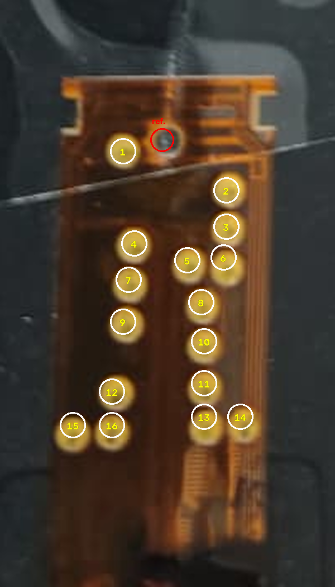
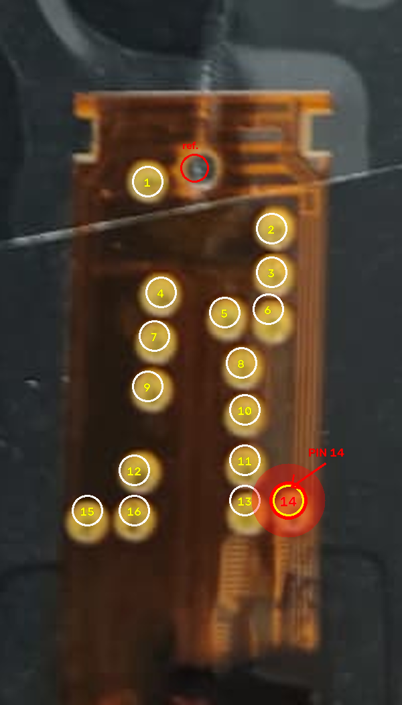

# hp46-dot-count-bypass

### Cómo saltar el bloqueo por conteo de gotas de tinta de HP en el cartucho HP 46 (proyecto de mapeo de pines)

> ✅ **Actualización:** se encontró el pin que funciona — ver la sección [Solución encontrada: Pin 14](#solución-encontrada-pin-14).

> ⚠️ **Fines educativos.** Este proyecto documenta un experimento de ingeniería inversa sobre hardware de tu propiedad, con fines educativos y de investigación personal. No está pensado para infringir leyes, términos de servicio, patentes ni ninguna política de HP o de terceros. Se invita a quien use esta información a hacerlo de forma responsable, únicamente sobre cartuchos propios y para uso personal/doméstico, respetando la normativa de su país.

## Por qué existe esto

Los cartuchos de tinta de HP no tienen un sensor real de nivel de tinta. Un chip en el cartucho cuenta cuántas gotas de tinta ha disparado el cabezal de impresión para cada color, y a partir de ese conteo estima cuánta tinta queda. El conteo nunca se reinicia solo — ni al rellenar el cartucho, ni al pasarlo a otra impresora. En el momento en que la impresora decide que el conteo está "vacío" (o no puede leer el chip), bloquea la impresión aunque el cartucho físicamente todavía tenga tinta.

Para familias de cartuchos HP más antiguas — HP 21/22, HP 27/28, HP 45/15, HP 56/57/58, HP 92/94, HP 300, HP 901, etc. — la comunidad ya descubrió hace tiempo qué contacto(s) físico(s) del chip tapar con cinta para que el firmware de la impresora se salte la lectura de ese valor de conteo al arrancar, saltando así el bloqueo (no borra el contador — solo lo oculta de la secuencia de lectura de la impresora, que entonces trata al cartucho como nuevo/lleno).

**Todavía no existe un mapa de pines documentado equivalente para el HP 46 (negro CZ637A / tricolor CZ638A)**, usado en la serie HP Deskjet 2520/2529/2540/2545/2548/Ink Advantage. Hay un puñado de publicaciones en foros con la misma pregunta, sin respuesta confirmada. Este repositorio documenta un intento de encontrar qué contacto(s) saltan el bloqueo por conteo de gotas en este chip específico, mediante prueba y error sistemático, ya que HP nunca publicó un pinout para él.

## Hardware

- **Impresora:** HP Deskjet serie 2520 (2529), solo USB, sin red/Wi-Fi.
- **Cartuchos:** HP 46 Negro (CZ637A) y HP 46 Tricolor (CZ638A).
- **Diseño del chip:** panel de contactos de circuito flexible con **16 contactos dorados**, organizados en dos columnas desfasadas (no en una sola fila como en los cartuchos HP más antiguos). Ver foto en `/photos`.

## Qué ya se probó (para no repetir pruebas)

- [x] Deshabilitar "Protección de cartucho HP" en el HP Toolbox (Propiedades de impresora → HP Toolbox → pestaña "Protección de cartucho de HP"). Sin efecto sobre los errores de "cartucho incompatible" / "cartucho faltante" — esa opción solo controla el bloqueo de chip entre impresoras, no la estimación de nivel de tinta.
- [x] Configurar el driver en "Sólo tinta negra" / escala de grises (Preferencias de impresión → Avanzadas → Imprimir en escala de grises). **No** salta la verificación de hardware de si el cartucho está físicamente presente o no.
- [x] Quitar físicamente el cartucho tricolor para forzar el modo de un solo cartucho: este modelo **no** soporta ese modo — bloquea el trabajo de impresión por completo con "Faltan cartuchos de tinta" y solo ofrece "Cancelar impresión", sin opción de continuar.
- [x] Limpieza de los contactos de cobre de ambos cartuchos y de los pines del carro con paño sin pelusa / alcohol isopropílico.
- [x] Reasentar ambos cartuchos (confirmando la ranura correcta: negro a la derecha, tricolor a la izquierda, según los iconos de la carcasa).
- [x] Revisión de cinta protectora sobrante sobre las boquillas — no se encontró ninguna.
- [x] **Prueba de los 16 contactos uno por uno** (nunca más de uno tapado a la vez) sobre el cartucho negro (CZ637A): los pines 1–13, 15 y 16 se probaron individualmente y no tuvieron ningún efecto observable. Solo el **pin 14** cambió el comportamiento de la impresora (ver sección siguiente).

## Metodología

1. Fotografiar y numerar cada uno de los 16 contactos (por posición de fila/columna).
2. Tapar **un solo** contacto con un pequeño trozo de cinta transparente — nunca cinta conductora, nunca más de un contacto a la vez.
3. Reinsertar el cartucho, apagar y encender la impresora.
4. Observar: ¿imprime una página de alineación automáticamente? ¿Sonido distinto? ¿Cambia la pestaña "Nivel de tinta estimado" del Toolbox?
5. Registrar el resultado, quitar la cinta, limpiar, pasar al siguiente contacto.

## Referencias de trucos de pines conocidos para OTRAS familias de cartuchos (solo para comparar el método — NO aplicable directamente al HP 46)

- HP 22/28/57 — https://elektrotanya.com/sites/default/files/forum/2014/08/Resett_ink_levels_%20HP_22_57.pdf
- HP 27/28/56/57/58 — https://support.bchtechnologies.com/hc/en-us/articles/201082505-How-to-reset-ink-level-for-27-28-56-57-58-OEM-Cartridges
- HP 21/22 — https://www.scribd.com/document/324587330/HP-Cartidges
- HP 92 — https://printer9988.blogspot.com/2015/05/how-to-reset-hp-92-cartridge.html

## Solución encontrada: Pin 14

Probando los 16 contactos uno por uno sobre el **cartucho negro (CZ637A)**, tapar el **pin 14** (ver foto numerada abajo) con un solo trozo de **cinta transparente normal (una sola capa)** hizo que la impresora dejara de leer el conteo de gotas de ese chip:

- Ya no apareció el error **"Faltan cartuchos de tinta"** al imprimir — el trabajo de impresión salió normal.
- La pestaña **"Nivel de tinta estimado"** del HP Toolbox dejó de mostrar la X roja / "--" para ese cartucho.

> ⚠️ **Importante:** al tapar este pin, la impresora ya no puede leer el conteo de gotas, así que **tampoco te avisará cuando el cartucho esté realmente vacío** — va a seguir "creyendo" que tiene tinta indefinidamente. Vigila manualmente cuánta tinta física le queda al cartucho; imprimir en seco por mucho tiempo puede dañar el cabezal de impresión.

Esta prueba se hizo solo sobre el cartucho **negro**. Todavía no está confirmado si el mismo pin 14 funciona igual en el cartucho **tricolor (CZ638A)**, ni si aplica a chips de generación similar como el HP 60/662/664 — si alguien lo prueba, una confirmación (o PR a este README) ayuda mucho.

## Aviso legal y de uso responsable

Este proyecto tiene **fines educativos y de investigación personal**. Es una modificación de hardware sobre un cartucho de tu propiedad, pensada para uso personal/doméstico. No se garantizan resultados, y una tapadura equivocada puede hacer que la impresora deje de reconocer el cartucho por completo (el mismo modo de falla que el problema original) en vez de "resetear" algo — la cinta no borra el contador interno del chip, solo oculta un dato de la secuencia de lectura de la impresora al arrancar.

Se comparte esta información únicamente con fines de aprendizaje y para documentar un experimento propio. No se invita ni se anima a usar este contenido para infringir los términos de servicio de HP, violar patentes, ni incumplir ninguna ley aplicable en tu país o región. Cada persona es responsable de verificar y respetar la normativa que le corresponda antes de intentar algo similar.
